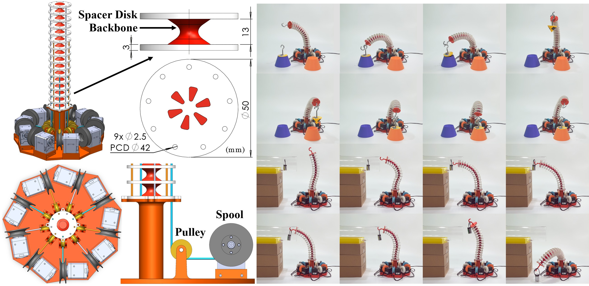
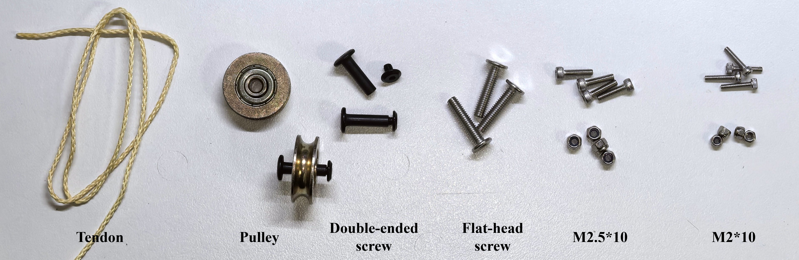
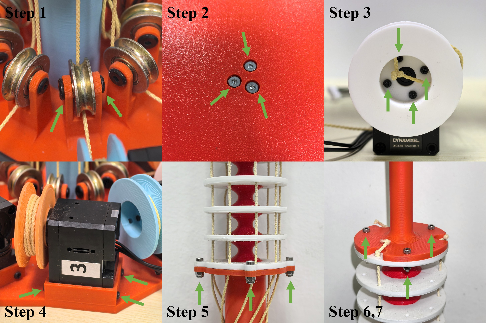

# CoLI: A Reproducible Platform for Continuum Robot Learning via Monolithic 3D Printing and Isomorphic Teleoperation
This is the open source repository for <CoLI: A Reproducible Platform for Continuum Robot Learning via Monolithic 3D Printing and Isomorphic Teleoperation>.

CoLI is a reproducible, open-source platform for continuum robot learning, featuring a monolithic 3D-printable design and isomorphic leader–follower teleoperation. By combining accessible dual-material 3D printing, a tendon-driven continuum robot, and intuitive teleoperation without complex inverse-kinematics computation, CoLI lowers the barrier to building and condudting initation learning-driven tasks with continuum robots. The platform futher supports Lerobot ecosystem to offer an easier approach for learning-driven tasks.

To learn more about the paper, please visit:

[Paper: https://arxiv.org/abs/2606.20389](https://arxiv.org/abs/2606.20389)

[Website: https://tangrobot.github.io/CoLI-website/](https://tangrobot.github.io/CoLI-website/)

Video: [Bilibili](https://www.bilibili.com/video/BV1HSTF6sEuy/?share_source=copy_web&vd_source=95bcfa8e28b1c93283ea8624e7b82aea)




## Required Material

Here is the materials required of an leader robot or an follower robot.

| Category | Item | Quantity / Specification |
|---|---|---|
| 3D-Printed Parts | `Continuum_robot` | 1 |
| 3D-Printed Parts | `Base` | 1 |
| 3D-Printed Parts | `Connection` | 1 |
| 3D-Printed Parts | `Spool` | 9 |
| 3D-Printed Parts | `End_effector` | 1 |
| Actuators | Dynamixel XC430-T240BB-T or XL330-M288-T servo | 9 |
| Actuators | Dynamixel U2D2 Hub | 1 |
| Actuators | Dynamixel PHB Set | 1 |
| Actuators | DC Power Supply | 1 (at least 5 A) |
| Tendons | Kevlar fiber tendon (1.5 mm diameter) | 3 × 30 cm, 3 × 45 cm, 3 × 60 cm |
| Pulleys | Pulley with bearing (U-shaped, Hole4 × 22 × 7 × 8 mm) | 9 |
| Screws | Double-ended screw and nut set (M3 × 14 mm, 4 mm outer diameter) | 9 |
| Screws | Flat-head screw (M4 × 18 mm) | 3 |
| Screws | Socket-head screw with lock nut (M2.5 × 10 mm) | 4 |
| Screws | Socket-head screw with lock nut (M2 × 10 mm) | 3 |




## 3D Printing Instruction

Please read the `README.md` file in each `CAD/XXX` fold and follow the instructions.

Overall, we recommend using the **Bambu Lab H2D 3D printer** (with dual 0.4 mm nozzles) to fabricate the continuum robot. We recommend using the provided `.3mf` files, which already include the printing profiles, to start your prints. Please follow the material types specified in each file.

You can also visit our MakerWorld model page ([CN](https://makerworld.com.cn/zh/models/3159310-coli-a-reproduceable-printable-continuum-robot#profileId-3724074)/[World](https://makerworld.com/models/3498238-coli-a-reproduceable-printable-continuum-robot#profileId-3996050)) to download the models and print them with a single click.

You will need to prepare the following printing materials.

- One spool of PLA filament (Bambu Lab PLA Basic recommended).
- One spool of TPU 95A filament (Bambu Lab TPU 95A HF recommended).
- One spool of Bambu Lab PLA Tough+ (recommended for printing `Base` and `Connection`, substitutable with generic PLA).

## Assembly Instructions

Follow the steps below to assemble the continuum robot, including both the leader and follower robots.

1. **Install the pulleys.** Use double-ended screw and nut sets to mount the nine pulleys at the designated positions around the center of the base.

2. **Connect the base components.** Connect `base` and `connection` with M4 × 18 mm flat-head screw.

3. **Install the spools on the servos.** Use the screws supplied with the Dynamixel servos to attach one `spool` to each servo horn. Repeat this procedure for all nine servos.

4. **Mount the servos.** Use the screws supplied with the Dynamixel servos to secure all nine servos to `base`.

5. **Mount the continuum robot body.** Remove the support material from `continuum_robot`. Then, use M2.5 × 10 screws and lock nuts to attach the continuum robot body to the base through its four mounting holes.

6. **Route and secure the tendons.** Cut the tendons to suitable lengths. For each tendon, pass one end through the hole in the corresponding `spool` and secure it with a knot. Route the other end through the pulley and upward through the tendon-routing holes in the continuum robot. Finally, secure the tendon with a knot above the appropriate spacer disk.

   - The tendon routing configuration can be customized to suit your needs. However, **the tendon routing must be identical on the leader and follower robots**. Each corresponding tendon must also be connected to the same servo ID on both robots.

   - For the recommended tendon routing configuration, refer to **Sec. III-A** of the [paper](https://arxiv.org/abs/2606.20389).

7. Install `End_effector` at the tip of `Continuum_robot` with M2 × 10 screws and lock nuts.

8. **Connect the servos.** Use the cables supplied by Dynamixel to connect the servos in a daisy chain. Connect the chain to the power supply board and the U2D2 Hub. Ensure that the power supply is rated for a current of **more than 5 A**.



## How to Use

Please refer to the `README.md` files under `Software/XXX` for instructions on controlling the robot.

We provide control code for direct motion mapping and integration code for the LeRobot framework.

Also, you may implement isomorphic teleoperation based on the [Dynamixel SDK](https://docs.robotis.com/docs/software/dynamixel_sdk/) and the actuation principles described in **Sec. III-B** of the [paper](https://arxiv.org/abs/2606.20389).

### Calibration

You will need to complete the calibration procedure before running each program.

1. Print the calibration sleeve model provided in `CAD/Calibrator`.
2. Before running the program, use the calibration sleeve to keep the robot in an upright position.
3. Run the program and wait for the tendons to tighten.
4. Remove the calibration sleeve and manually adjust any spacer disks that are not in their desired positions. Please ensure that all tendons are routed correctly, especially at the pulley.
5. Follow the command-line instructions and press the confirmation key when prompted.

### Direct Mapping

The files in `Software/Direct_mapping` provide direct motion mapping from the leader robot to the follower robot.

To use this feature:

1. Configure the port, baud rate, and servo IDs in `leader_M288.py` and `Follower_T240.py`.
1. Run program `leader_M288.py` and complete the calibration procedure.
2. Run program `Follower_T240.py` and complete the calibration procedure.
3. Motion mapping between the leader and follower robots will begin automatically.

### LeRobot Integration

We provide LeRobot-compatible integration code. Please refer to the [LeRobot Instructions](https://huggingface.co/docs/lerobot/main/en/integrate_hardware) for guidance on controlling the robot through the LeRobot framework.

## About This Project

If you encounter any issues during the fabrication or assembly process, feel free to raise them in the GitHub **Issues** section or contact us via email at [tangzy2026@shanghaitech.edu.cn](mailto:tangzy2026@shanghaitech.edu.cn).

If you successfully replicate our robot, we would love to hear from you and see your results!

This work was published at IEEE/RSJ IROS 2026. If you use our work in your research or publications, please cite:

```code
@misc{tang2026coli,
      title={CoLI: A Reproducible Platform for Continuum Robot Learning via Monolithic 3D Printing and Isomorphic Teleoperation}, 
      author={Ziyuan Tang and Chenxi Xiao},
      year={2026},
      eprint={2606.20389},
      archivePrefix={arXiv},
      primaryClass={cs.RO},
      url={https://arxiv.org/abs/2606.20389}, 
}
```
